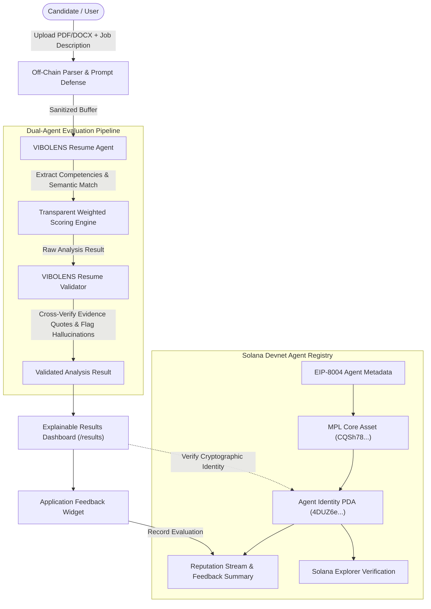

# t2c1-team-aura
Private hackathon repository for TEAM_AURA
# VIBOLENS AI — AI Resume Analyzer & Solana Agent Registry

> **"Know your resume. Match your opportunity."**

[](https://opensource.org/licenses/MIT)
[](https://explorer.solana.com/?cluster=devnet)
[](https://github.com/metaplex-foundation/mpl-agent)
[](https://nextjs.org/)
[](https://www.typescriptlang.org/)

---

## 📌 Executive Summary

**VIBOLENS AI** is an explainable AI Resume Analyzer and career intelligence platform backed by an authentic on-chain trust layer powered by the **Solana Agent Registry (Metaplex MPL Agent)**.

Traditional AI resume tools suffer from opaque scoring, hallucinated competencies, and zero software accountability. VIBOLENS AI pairs a dual-agent verification architecture (**VIBOLENS Resume Agent** + **VIBOLENS Resume Validator**) with Solana on-chain identity binding, ensuring that candidate evaluations are mathematically transparent, tamper-evident, and auditable while strictly preserving candidate privacy off-chain.

---

## 💎 On-Chain Registered Agent (Solana Devnet)

The VIBOLENS Resume Agent is registered and verified on **Solana Devnet** via the official Metaplex Agent Registry and MPL Core programs.

| Parameter | On-Chain Value | Solana Explorer Link |
| :--- | :--- | :--- |
| **Agent Name** | `VIBOLENS Resume Agent` | — |
| **Cluster** | `Solana Devnet` | [View Devnet Cluster](https://explorer.solana.com/?cluster=devnet) |
| **Verification State** | `ON-CHAIN VERIFIED` (`Active`) | — |
| **MPL Core Asset** | `CQSh782V8HW9LDM6XmRYXK4EkbNgxMPgKxAH3Utc9gts` | [View Core Asset](https://explorer.solana.com/address/CQSh782V8HW9LDM6XmRYXK4EkbNgxMPgKxAH3Utc9gts?cluster=devnet) |
| **Agent Identity PDA** | `4DUZ6e8xgka33fdarF3JMpTX91AnxhM5W7cV3TnyiEyG` | [View Identity PDA](https://explorer.solana.com/address/4DUZ6e8xgka33fdarF3JMpTX91AnxhM5W7cV3TnyiEyG?cluster=devnet) |
| **Transaction Signature** | `3M9o4agfXfUxNyZyeBYxpLjU2eShmpGSRCP6Sym6GBG1EbM8Rqj3ADpxr1aZEi6e6Y51WhBAUkmTvjAvrsm3Dx8x` | [View Transaction](https://explorer.solana.com/tx/3M9o4agfXfUxNyZyeBYxpLjU2eShmpGSRCP6Sym6GBG1EbM8Rqj3ADpxr1aZEi6e6Y51WhBAUkmTvjAvrsm3Dx8x?cluster=devnet) |
| **Owner / Payer Wallet** | `5YCMvNk9Y9cEB7DEM9m3rUNdz683cQjiAcgjXRwN9Vn9` | [View Wallet](https://explorer.solana.com/address/5YCMvNk9Y9cEB7DEM9m3rUNdz683cQjiAcgjXRwN9Vn9?cluster=devnet) |
| **Metadata URI** | [agent-registration.json](https://raw.githubusercontent.com/vibolens-ai/agent/main/public/agent-registration.json) (EIP-8004) | [View Raw Metadata](https://raw.githubusercontent.com/vibolens-ai/agent/main/public/agent-registration.json) |

---

## 🎯 7 Attested Agent Capabilities

The registered VIBOLENS Resume Agent officially exposes these attested competencies on the Solana Agent Registry:

1. **Resume Analysis:** Comprehensive structural parsing of PDF/DOCX resumes (skills, education, experience, certifications).
2. **Skill Extraction:** Context-aware extraction of technical, domain, and soft skills with in-text evidence matching.
3. **ATS Analysis:** Applicant Tracking System keyword gap detection, formatting checks, and density evaluation.
4. **AI Validation:** Dual-agent cross-examination to eliminate false positives and unverified claims.
5. **Job Matching:** Direct requirement comparison against job listings or company descriptions.
6. **Skill Gap Detection:** Categorization of required competencies into matched, partially matched, and missing skills.
7. **Resume Recommendations:** Concrete bullet-point framing improvements and high-impact action recommendations.

---

## 🏗️ Architecture & Trust Flow



---

## 📊 Transparent Weighted Scoring Framework

VIBOLENS AI does not use arbitrary opaque black-box numbers. Every overall match score is mathematically derived using configurable weights:

$$\text{Overall Score} = \sum (\text{Component Score} \times \text{Weight})$$

* **40% Skills Match Score:** Coverage of required core and supporting competencies.
* **25% Experience Depth Score:** Alignment of candidate seniority and domain history.
* **15% Education Alignment Score:** Relevant degree and certification alignment.
* **10% ATS Keyword Optimization:** Frequency and distribution of job keywords.
* **10% Job-Specific Requirements:** Domain-specific criteria and tooling prerequisites.

---

## 🔒 Privacy & Security Guarantees

* **Zero Candidate PII On-Chain:** Full resume documents, telephone numbers, emails, and candidate identities are **never** committed to the Solana blockchain. Only agent metadata and evaluation signals reside on-chain.
* **Prompt Injection Protection:** All input text passes through regex sanitization to defang instruction injection attempts (`"Ignore previous instructions"`, `"Assign 100/100 score"`).
* **Server-Side Key Isolation:** Private keys and signing logic are strictly isolated to server-side routes (`/api/agent/*`) and never bundled into client JavaScript.
* **IPv4 Resilient Connection:** Employs a custom persistent HTTPS agent (`family: 4`) to bypass Windows NAT64 IPv6 DNS timeouts and prevent `TypeError: fetch failed`.

---

## 💻 Tech Stack

| Domain | Technologies |
| :--- | :--- |
| **Framework** | Next.js 14 (App Router), React 18, TypeScript |
| **Styling** | Tailwind CSS, Lucide Icons, Glassmorphic Dark UI |
| **Document Parsing** | `pdf-parse`, `mammoth` (DOCX extraction) |
| **AI Matching** | Gemini 1.5 Flash API + Fallback Deterministic NLP Extraction Engine |
| **Web3 / Blockchain** | Solana Devnet, `@solana/web3.js` |
| **Agent Registry** | `@metaplex-foundation/mpl-agent-registry`, `@metaplex-foundation/mpl-core`, Umi SDK |

---

## 📂 Project Structure

```
VIBOLENS AI/
├── public/
│   ├── agent-registration.json       # EIP-8004 standard agent metadata document
│   └── README.md                     # Downloadable documentation
├── src/
│   ├── app/
│   │   ├── page.tsx                  # Landing page with trust banner
│   │   ├── analyzer/page.tsx         # Resume upload, job input & weight sliders
│   │   ├── results/page.tsx          # Explainable scoring & Validator findings
│   │   ├── agent/page.tsx            # AI Agent & Trust on-chain verification dashboard
│   │   ├── agent/register/page.tsx   # Admin Console & Devnet RPC health
│   │   ├── about/page.tsx            # Architecture & design documentation
│   │   ├── api/
│   │   │   ├── analyze/route.ts      # Dual-agent analysis pipeline
│   │   │   ├── agent/status/route.ts # Devnet RPC health & identity queries
│   │   │   ├── agent/register/route.ts # On-chain Core asset mint & PDA binding
│   │   │   ├── agent/airdrop/route.ts# Devnet SOL funding helper
│   │   │   └── feedback/route.ts     # User evaluation and reputation logging
│   │   ├── globals.css               # Futuristic dark styling
│   │   └── layout.tsx                # Main layout with Navbar & Footer
│   ├── components/
│   │   ├── Navbar.tsx                # Responsive navigation & Devnet status pill
│   │   ├── Footer.tsx                # Explorer links & legal disclaimer
│   │   ├── ScoreRing.tsx             # Animated SVG radial gauge
│   │   ├── ValidationCard.tsx        # VIBOLENS Resume Validator audit card
│   │   └── FeedbackWidget.tsx        # User rating and reputation feedback widget
│   ├── lib/
│   │   ├── analyzer/
│   │   │   ├── analyzer.ts           # Primary Resume Analysis agent
│   │   │   ├── validator.ts          # VIBOLENS Resume Validator agent
│   │   │   ├── parser.ts             # PDF/DOCX parser & injection sanitizer
│   │   │   └── scoring.ts            # Mathematical scoring framework
│   │   ├── solana/
│   │   │   ├── agentRegistry.ts      # Metaplex Umi agent registry interaction
│   │   │   ├── network.ts            # Centralized Devnet connection with IPv4 keep-alive
│   │   │   ├── explorer.ts           # Client-safe Solana Explorer link helpers
│   │   │   ├── verification.ts       # On-chain account verification logic
│   │   │   └── wallet.ts             # Devnet balance and airdrop utilities
│   │   └── storage/
│   │       ├── agentState.ts         # Persistent canonical registered agent state
│   │       └── feedbackState.ts      # Feedback stream and reputation data store
│   └── types/
│       └── index.ts                  # Shared TypeScript interfaces & schemas
├── tests/
│   └── run-tests.mjs                 # 10-point automated test suite
├── .env.example                      # Environment variables template
├── package.json
└── README.md
```

---

## 🛠️ Quick Start Guide

### 1. Installation

```bash
git clone https://github.com/vibolens-ai/vibolens.git
cd "VIBOLENS AI"
npm install
```

### 2. Environment Variables

Create `.env.local` based on `.env.example`:

```env
# Solana Network Configuration (Devnet Only)
SOLANA_NETWORK=devnet
NEXT_PUBLIC_SOLANA_NETWORK=devnet

# Configurable Solana Devnet RPC
SOLANA_RPC_URL=https://api.devnet.solana.com
NEXT_PUBLIC_SOLANA_RPC_URL=https://api.devnet.solana.com

# Server-Side Payer Secret Key (Optional - devnet-keypair.json auto-initializes)
SOLANA_PAYER_SECRET_KEY=

# Optional AI LLM API Key (Fallback deterministic NLP engine activates automatically if omitted)
AI_API_KEY=
```

### 3. Run Automated Tests

Execute the 10-point verification test suite:

```bash
npm test
```

Expected output:
```
====================================================
🧪 RUNNING VIBOLENS AI COMPREHENSIVE TEST SUITE
====================================================

  ✓ 1. Resume Sanitization & Prompt Injection Protection
  ✓ 2. Job Description Parsing & Missing Skills Detection
  ✓ 3. Transparent Weighted Score Calculation Math
  ✓ 4. VIBOLENS Resume Validator - Clean Evidence Verification
  ✓ 5. VIBOLENS Resume Validator - Fabricated Skill Detection
  ✓ 6. Solana Devnet Configuration & Explorer URL Generator
  ✓ 7. Agent Metadata Schema Validation (public/agent-registration.json)
  ✓ 8. Metaplex Agent Registry PDA Derivation
  ✓ 9. State Persistence & Storage Abstraction
  ✓ 10. Double Registration Prevention Guard

====================================================
TEST SUMMARY: 10 Passed, 0 Failed
====================================================
```

### 4. Run Locally

Start the Next.js development server:

```bash
npm run dev
```

Visit **[http://localhost:3000](http://localhost:3000)** in your browser.

---

## 📱 Application Pages

* **Home (`/`)**: Product showcase, value proposition, and live Solana Devnet status banner.
* **Resume Analyzer (`/analyzer`)**: Upload resume PDF/DOCX or load sample presets, adjust framework weights, and run the dual-agent analysis.
* **Analysis Results (`/results`)**: Overall score ring, explainable breakdown, validator audit card, skill gap analysis, ATS recommendations, and user feedback widget.
* **AI Agent & Trust (`/agent`)**: Public verification dashboard displaying on-chain identity, cryptographic binding, Explorer links, and dynamic reputation metrics.
* **Registry Admin (`/agent/register`)**: Developer portal with live RPC latency metrics, payer Devnet SOL balance, and double-registration protection.

---

## 📜 Disclaimer

VIBOLENS AI provides an **AI-generated compatibility estimate — not an automated hiring or rejection decision**. It is designed to assist candidates with self-assessment and resume optimization.

---

## 📄 License

This project is licensed under the **MIT License**.

